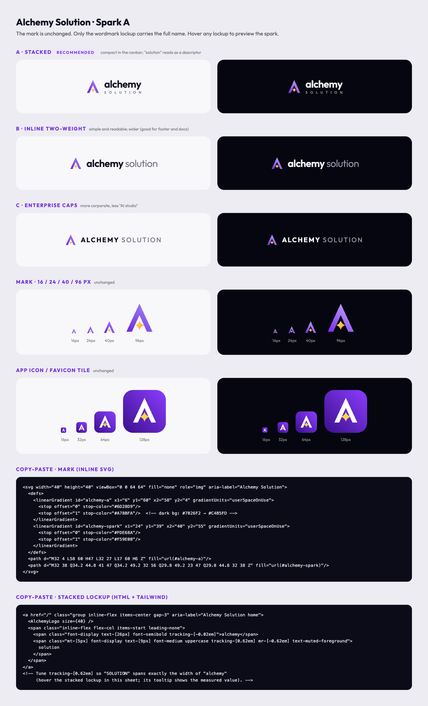
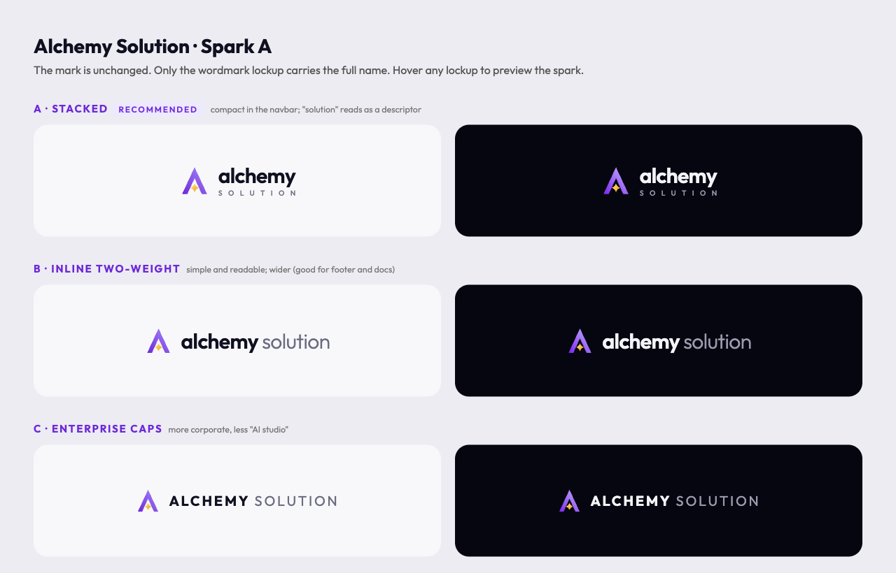
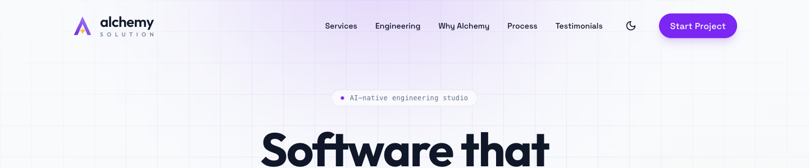
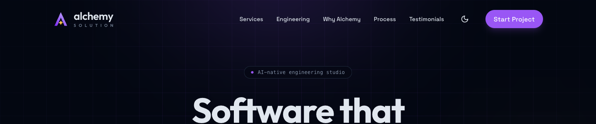
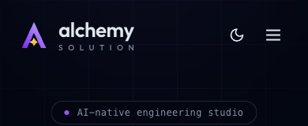

# Services Showcase and Alchemy Solution Logo: Decisions & Implementation Brief

> **Status: approved.** Ready for implementation.
> **Branch:** `feature/big-changes` · **Stack:** Astro 5 + React 19 islands, Tailwind v4, framer-motion 12, lucide-react
> **Assets:** [`docs/design/`](./design/)

## Decisions

| # | Topic | Decision |
|---|---|---|
| 1 | Services layout | **Interactive service showcase**: a list on the left and one large animated scene on the right (an accordion on mobile). |
| 2 | Services visuals | **Code-built "concept scenes"**: small animated UIs drawn with HTML/SVG and framer-motion. No screenshots, images or video. |
| 3 | Logo | **Spark A** mark with the **stacked "alchemy / SOLUTION"** wordmark. |
| 4 | Default theme | **Dark** (already the default in code). Keep the toggle. |
| 5 | Brand name | **Alchemy Solution**, singular, matching the domain `alchemysolution.org` (was "Alchemy" / "Alchemy Engineering"). This avoids confusion with alchemy.com, the Web3 platform. **Do not "correct" it to "Solutions".** |

---

## 1. Services: we have no products yet, so we generate the visuals

The scenes are **not screenshots of real products**. They are small animated mockups that Qwen builds in code, showing the kind of thing we build for a client. That works in our favour:

* No design files, stock photos or real client screens are needed. Everything is JSX + Tailwind + framer-motion.
* They use theme tokens, stay sharp at any size, and add almost nothing to page weight.
* Text and numbers live in code, so we can swap in real figures as soon as we have real projects.

### Honesty rules (important for trust)
1. **Unbranded and generic.** Use placeholders like `yourproduct.com`, "Your team", "Limited Drop". No real company names or logos.
2. **Every scene shows an `illustrative` pill** in its window chrome (top right, mono, 10px, muted). Buyers in B2B notice made-up numbers, and labelling them protects our credibility.
3. Numbers should be **plausible, not extreme**. Where possible, reuse the figures from `CASE_STUDIES_DRAFT.md` so the site tells one consistent story.
4. When real projects ship, replace the scene data with real metrics and remove the pill.

### Visual style shared by all scenes
* Every scene sits in a **`SceneFrame`**: the same dark "terminal window" style as the hero's mission-control panel. Rounded 2xl, top bar with three dots (red/amber/green, 10px), mono title on the left (e.g. `alchemy — agents`), and the `illustrative` pill on the right.
* **The scene is always dark, in both light and dark mode**, like a device screen. This matches the hero and means each scene only needs to be designed once.
* Fonts: UI text in Space Grotesk / Outfit (already loaded); data labels in `font-mono`.
* Colours: primary violet for highlights and active states, accent gold for "result / win" moments, emerald-400 for success ticks and status, slate-500/600 for skeletons.
* Size: desktop stage about **520px tall**, scene body fills it. Mobile about **280px tall**; simplify by hiding secondary columns.
* Loop length: **6s** per scene, with ease `[0.22, 1, 0.36, 1]` (the same as the ContactForm).

---

## 2. Final service lineup and copy

Order matters: **AI first**, because it's our differentiator and matches the hero ("AI-native engineering studio").

| # | Label | Headline | One-liner | Best for | Tags | Contact `projectType` | Scene |
|---|---|---|---|---|---|---|---|
| 1 | **AI Agents & Automation** | Put busywork on autopilot. | AI agents that read your documents, answer your team, and run workflows inside Slack, Jira and your own tools. | Teams buried in tickets, docs and manual processes | RAG · Copilots · Workflow Automation | `ai-agent` | `AgentScene` |
| 2 | **Web Apps & Platforms** | Software your customers love to use. | Fast, reliable web apps, from first MVP to platforms serving millions. | SaaS products, dashboards, internal tools | React / Next.js · APIs · Scalable Backends | `web-app` | `WebAppScene` |
| 3 | **E-Commerce** | Stores that sell, even on launch day. | Headless storefronts that load in under a second and stay up during your biggest drops. | DTC brands and retailers outgrowing their platform | Shopify Headless · Edge Caching · Personalisation | `ecommerce` | `CommerceScene` |
| 4 | **Cloud & DevOps** | Ship every day. Never go down. | Automated pipelines and resilient infrastructure on any cloud or on-premise, with full monitoring. | Teams with slow releases or fragile servers | Kubernetes · Terraform · CI/CD · Observability | `infra` | `PipelineScene` |
| 5 | **Architecture & Strategy** | The right plan before the first line of code. | Senior architects map your system, cut cloud costs, and set a roadmap that scales. | Founders and CTOs facing a big technical decision | System Design · Cost Optimisation · Roadmaps | `other` | `BlueprintScene` |

> This replaces the old five ("Scalable Software Solutions", "Custom Web Applications", ...). Those two overlapped, and e-commerce was missing even though it appears in the contact form and in Case Study 02.

**Section header**
* Eyebrow: `What we do`
* H2: `What we build <span class="text-gradient">for you</span>`
* Sub: `Five ways we turn ideas into production software.`

---

## 3. Scene storyboards (6s loop each; times are seconds from loop start)

### 3.1 `AgentScene`: "Ask → Retrieve → Answer"
Chrome title: `alchemy — agents`
Layout: a narrow left rail of channels (`# support` active, `# ops`, `# sales`) and a chat pane on the right.

| Time | What happens |
|---|---|
| 0.0 | Empty chat pane; the channel rail is visible. |
| 0.3 | A user message slides up (y 12→0, fade): avatar circle "JD", text **"What's our refund policy for EU customers?"** |
| 1.0 | An agent row appears: Spark A mini-mark avatar, name **"Alchemy Agent"**, status `Searching knowledge base…` with a spinning ring. |
| 1.2–2.4 | Three document chips fly in from the right (x 24→0, staggered 0.3s), then each gets an emerald tick: `refund-policy.pdf`, `eu-terms.md`, `support-handbook.docx`. |
| 2.6–4.2 | The answer bubble types out word by word: **"EU customers can request a full refund within 14 days of delivery. Digital goods are excluded once downloaded."** |
| 4.2 | Citation chips pop in (violet outline): `[1] refund-policy.pdf §4.2`, `[2] eu-terms.md`. |
| 4.5 | A gold badge fades in at the bottom: `⚡ Answered in 2.1s · sources cited` |
| 5.6–6.0 | Everything fades out and the loop restarts. |

### 3.2 `WebAppScene`: "Wireframe → Product"
Chrome title: `alchemy — app` · Inside: a mini browser bar showing URL `app.yourproduct.com/dashboard`.

| Time | What happens |
|---|---|
| 0.0–1.0 | Grey **skeleton** blocks shimmer: sidebar, three KPI cards, chart area, three table rows. |
| 1.2–2.4 | KPI cards turn into real content (staggered), with numbers counting up: `Revenue $48.2k ▲12%`, `Active users 3,914`, `Churn 1.8%`. |
| 2.4–3.6 | The chart line draws in (SVG `pathLength` 0→1), with a violet gradient area fading in underneath. |
| 3.6–4.6 | Three table rows slide in (name, status pill, amount). |
| 4.6–5.4 | A ring in the top right counts **0 → 100** with the label `Performance`; the ring turns emerald at 100. |
| 5.6–6.0 | Fade out and restart. |

### 3.3 `CommerceScene`: "Launch-day traffic spike"
Chrome title: `alchemy — storefront`
Layout: left, a product card (abstract gradient product shape, tag `LIMITED DROP`, `$129`, an "Add to cart" button). Right, a "Visitors / min" sparkline with stats below it.

| Time | What happens |
|---|---|
| 0.0–1.0 | Calm: the sparkline is low and the visitor counter shows `1,200`. |
| 1.0 | A `● DROP LIVE` pill starts pulsing (gold). |
| 1.0–2.5 | The sparkline spikes and the counter climbs to **48,000**. The `Page load 0.4s` badge **stays emerald** the whole time. |
| 2.5–4.5 | Order toasts stack on the right, at most three visible: `Order #10421 · $129`, `#10422`, `#10423`... A revenue counter climbs to **$186,450**. |
| 4.5 | A stat row fades in: `Checkout uptime 100%`. |
| 5.6–6.0 | Fade out and restart. |

### 3.4 `PipelineScene`: "Commit → Live, auto-scaling"
Chrome title: `alchemy — deploy`

| Time | What happens |
|---|---|
| 0.0 | A row of five nodes joined by a line: `Commit → Tests → Build → Deploy → Live`, all grey. |
| 0.2–4.0 | A glowing violet dot travels along the line. Each node turns into an emerald ✓ as the dot reaches it (about 0.75s apart). Captions appear under the nodes: `a3f9c1` · `214 passed` · `1.2 MB` · `zero-downtime` · `v2.4.1`. |
| 1.0–2.2 | Bottom half: a "Servers" row starts with **2** squares and a `Load` bar rises to 85% (amber). |
| 2.2–3.2 | Four more server squares pop in (scale 0→1, staggered); the load bar drops to 40% (emerald). |
| 4.2 | Footer counters fade in: `Deploys this week 38` · `Uptime 99.99%`. |
| 5.6–6.0 | Fade out and restart. |

### 3.5 `BlueprintScene`: "Plan the system, cut the cost"
Chrome title: `alchemy — architecture` · Background: a subtle blueprint grid (violet lines at 8% opacity).

| Time | What happens |
|---|---|
| 0.0–2.5 | Boxes draw their outlines (stroke-dash) one after another: `Users → CDN → API Gateway → [Auth · Orders · Search] → Postgres + Redis`. Arrows draw between them. |
| 2.0–3.0 | Sticky-note annotations fade in at an angle: `auto-scaling`, `multi-region`, `cached at edge`. |
| 2.5–4.5 | Right panel, "Monthly cloud cost": the number counts down from **$18,400 → $11,200**, a bar shrinks, and a gold chip `−39%` pops in. |
| 5.6–6.0 | Fade out and restart. |

---

## 4. Interaction spec

* **Desktop (`lg+`)**: grid `lg:grid-cols-[minmax(0,5fr)_minmax(0,7fr)] gap-10`.
  * The left list shows all five items. The active item expands to show its headline, one-liner, "Best for", tags, and a **"Talk about this →"** link, plus a thin progress bar at the bottom.
  * Inactive items show only the label and headline, at 60% opacity.
  * Right: the stage (`lg:sticky lg:top-28`) holds a `SceneFrame` with the active scene.
* **Auto-advance** every 6s, in sync with the scene loop. The pause is **engagement-based**: the loop pauses only while the pointer is *actively moving over the tab list* (the controls column), and auto-resumes ~2s after the pointer goes still. Merely resting the cursor over the section or the stage never pauses it — that was the bug where arriving visitors saw the carousel frozen. Clicking an item selects it and restarts the timer. Keyboard focus (`:focus-visible`) inside the list also pauses until focus leaves.
* Arriving at the section (scrolling it into view) **resets to the first tab** and replays its storyboard from the start, then advances.
* **Scene change**: `AnimatePresence mode="wait"` with fade + y 8px, 0.4s.
* **Only the active scene is mounted.** Pause the timer and animations when the section is off-screen (`useInView` from framer-motion, `amount: 0.3`).
* **`prefers-reduced-motion`** (`useReducedMotion`): no auto-advance and no looping. Each scene renders its final frame.
* **Mobile (`< lg`)**: an accordion with one item open (the first by default). The open item shows its scene (about 280px) above the text. No auto-advance.
* **Accessibility**: the list is a `role="tablist"` with `aria-orientation="vertical"`; items are `role="tab"` with `aria-selected` and `aria-controls`; the stage is `role="tabpanel"`. Up/Down arrows move between items. Scene contents are `aria-hidden="true"` because the copy carries the meaning.
* **"Talk about this →"**: `window.dispatchEvent(new CustomEvent("alchemy:select-service", { detail: projectType }))`, then smooth-scroll to `#contact`.

### A simple way to loop the scenes
Remount the scene each cycle with a counter `key`, so framer-motion `initial → animate` replays cleanly. This avoids complex timelines:

```tsx
function useLoopKey(ms: number, running: boolean) {
  const [k, setK] = useState(0);
  useEffect(() => {
    if (!running) return;
    const id = window.setInterval(() => setK((n) => n + 1), ms);
    return () => window.clearInterval(id);
  }, [ms, running]);
  return k;
}
// <AgentScene key={loopKey} reduced={reduced} />
// Inside scenes: use `transition={{ delay: 1.2 }}` etc. to follow the storyboard times.
// When `reduced` is true, pass `initial={false}` so elements render in their final state.
```

For count-ups, use framer-motion `animate(from, to, { duration, onUpdate })` inside a `useEffect`, or `useMotionValue` + `useTransform`, with `Intl.NumberFormat` for formatting.

---

## 5. Logo: Spark A · Alchemy Solution



**What it means**: the "A" is also the alchemical triangle (transformation). The **gold spark** sits where the crossbar would be: raw input turned into gold, and a nod to AI.
**The rename to "Alchemy Solution" does not change the mark.** The "A" still stands for Alchemy. Only the wordmark lockup carries the full name.

**Files** (in `docs/design/logo/`)
| File | Use |
|---|---|
| `logo-mark.svg` | Mark for light backgrounds (violet `#6D28D9 → #A78BFA`) |
| `logo-mark-on-dark.svg` | Mark for dark backgrounds (violet `#7B26F2 → #C4B5FD`) |
| `logo-tile.svg` | Favicon / app icon (white A + gold spark on a violet tile) |
| `logo.html` | Logo sheet: lockup options, sizes, hover interaction, copy-paste SVG and lockup code. Open it in a browser. |

### Lockup: stacked (chosen)



| Element | Spec |
|---|---|
| Mark | Spark A, **38px** in the navbar (36px in the footer) |
| Line 1 | `alchemy`: Outfit **600**, **26px**, `tracking-[-0.02em]`, `leading-none`, foreground colour |
| Line 2 | `SOLUTION`: Outfit **500**, **10px**, uppercase, `tracking-[0.66em]` with `mr-[-0.66em]` (cancels the trailing space so it lines up exactly under "alchemy"), `mt-[5px]`, `text-muted-foreground` |
| Gap | 12px (`gap-3`) between mark and text |
| Accessible name | `aria-label="Alchemy Solution home"` on the link |

* Spark gold: `#FDE68A → #F59E0B` (tile version: solid `#FCD34D`).
* **Hover**: only the spark moves (rotates 90°, scales to 1.15, soft gold glow, 0.5s). **The A never rotates.** Disable under reduced motion.
* Minimum size: mark alone 16px. Below about 120px of available width, show the **mark only** and drop the wordmark.
* In running text, write the name as **"Alchemy Solution"** (title case). The lowercase form is only for the logo.

| Light nav | Dark nav |
|---|---|
|  |  |

Mobile (390px): 

---

## 6. Default theme: dark

**Keep dark as the default** (it's already set: `<html class="dark">` and `defaultTheme = "dark"`).
* The brand colours (violet glow, gold gradient) look best on dark. In light mode the hero gradient "ships itself" turns a muddy brown-orange.
* The hero's mission-control panel and the new concept scenes are dark "screens", so a dark page around them looks consistent and premium.
* It matches what this audience expects from AI and dev-tool brands (Linear, Vercel, Raycast) and what `SITE_IMPROVEMENTS.md` asks for ("Dark Mode Native").
* **Keep the light toggle.** Some executives prefer light for reading, and the choice is already saved in `localStorage`.

**Small fix to include**: in `Layout.astro`, the theme script sits **after `</html>`**. Move it to the **top of `<head>`** (`<script is:inline>`) so visitors who chose light don't see a flash of dark on load.

---

## 7. Implementation tasks for Qwen

### Task A: Logo (do this first; it's small)
1. Rewrite `src/components/AlchemyLogo.tsx`:
   * Paths from `docs/design/logo/logo-mark.svg`.
   * Gradient IDs come from React **`useId()`**. The logo renders three times per page, and the current hard-coded IDs create duplicates.
   * Props: `variant?: "mark" | "tile"` (default `"mark"`), `size?: number` (default 36), `className?`. Keep `width`/`height` props working for existing callers (Footer, 404).
   * Light/dark gradient: render both `<stop>` sets with `dark:hidden` / `hidden dark:block` on two gradients, or put CSS variables on the `<svg>` element (`[--a1:#6D28D9] dark:[--a1:#7B26F2]`) and use `style={{ stopColor: "var(--a1)" }}` on the stops. Note that the vars must be set on the `<svg>` itself or an ancestor *inside the same SVG*.
   * Give the spark path the class `logo-spark` (`transform-box: view-box; transform-origin: 32px 47px; transition: transform .5s cubic-bezier(.22,1,.36,1)`). Use `group-hover:` to rotate 90° and scale 1.15. Add a `motion-reduce:` override.
2. `src/components/islands/ThemeProvider.tsx`: in the navbar (about L67–72) and the mobile menu (about L140), **remove** the `motion.div whileHover={{ rotate: 180 }}` wrapper. Replace the `ALCHEMY` span with the **stacked lockup** from §5. Copy-paste markup is in `docs/design/logo/logo.html` → "Copy-paste · stacked lockup". Consider a small `AlchemyLockup` component so the navbar, mobile menu and footer all share it.
3. `src/components/sections/Footer.astro`: use the same lockup (mark 36px). Change `footerTitle` (the giant background word) to `"alchemy"`. "solution" isn't needed there.
4. `src/pages/404.astro`: check the 80px logo still looks right.
5. `public/favicon.svg`: replace its contents with `docs/design/logo/logo-tile.svg`. Add `public/apple-touch-icon.png` (180×180 render of the tile). In `Layout.astro` add `<link rel="apple-touch-icon" href="/apple-touch-icon.png">` and `<meta name="theme-color" content="#7B26F2">`.

### Task B: Services showcase
1. Create `src/components/islands/service-scenes/`:
   * `SceneFrame.tsx`: the shared dark window chrome (three dots, mono title, `illustrative` pill).
   * `AgentScene.tsx`, `WebAppScene.tsx`, `CommerceScene.tsx`, `PipelineScene.tsx`, `BlueprintScene.tsx`, each following its storyboard in §3. Props: `{ reduced?: boolean; compact?: boolean }` (`compact` = mobile layout).
   * `useLoopKey.ts` (see §4) and a small `CountUp.tsx` helper.
   * Rules: **no images and no new npm dependencies.** Plain divs/SVG, Tailwind, framer-motion, lucide-react icons only.
2. Rewrite `src/components/islands/Services.tsx`:
   * Keep the `Props.data?` shape (for Sanity later). Extend `Service` with `headline`, `bestFor`, `projectType`, `scene`.
   * Default data comes from the table in §2. Header copy as in §2.
   * Layout and behaviour as in §4.
3. `src/components/islands/ContactForm.tsx`: add a `useEffect` that listens for `alchemy:select-service` and calls `chooseType(e.detail)` if the value is a valid `ProjectTypeId`. Clean up the listener on unmount.
4. `src/components/sections/Footer.astro`: update the "Services" link list to the five new labels.

### Task C: Theme flash fix
* `src/layouts/Layout.astro`: move the inline theme script into the top of `<head>` (see §6).

### Task D: Rename to "Alchemy Solution"
Change **customer-facing brand text only**. Leave alone: internal identifiers (`alchemy-ui-theme` storage key, the `alchemy:select-service` event, component names like `AlchemyLogo`), the "Why Alchemy" section title, and the playful CLI text in the hero (`alchemy deploy --prod`, `alchemy — mission control`), since a short product-style name reads naturally there.

| File | Current | Change to |
|---|---|---|
| `src/pages/index.astro` L18 | `title="Alchemy - Software Development"` | `title="Alchemy Solution · AI-Native Software Engineering"` |
| `src/pages/404.astro` L6 | `title="404 - Alchemy"` | `title="404 · Alchemy Solution"` |
| `src/layouts/Layout.astro` L65 (JSON-LD) | `"name": "Alchemy Engineering"` | `"name": "Alchemy Solution"`, and add `"alternateName": "Alchemy"` |
| `src/layouts/Layout.astro` | default `<title>` / `og:site_name` (if present) | `Alchemy Solution` |
| `src/components/sections/Footer.astro` L229 | `© {year} Alchemy Engineering.` | `© {year} Alchemy Solution.` |
| `src/components/islands/ContactWidget.tsx` L148 | `Talk to Alchemy` | `Talk to Alchemy Solution` (or keep "Talk to us" if space is tight) |
| `src/lib/constants.ts` L122 | `"Hi Alchemy! …"` | `"Hi Alchemy Solution! …"` |
| `src/components/sections/CaseStudies.astro` L216 | `The Alchemy fix` | Keep. A short name is fine in running copy. |
| `src/components/sections/Testimonials.astro` L29 | `"Alchemy didn't just build us…"` | Keep. Customers naturally shorten names. |

> [!WARNING]
> **Social links point to the wrong accounts.** `Footer.astro` (L26–36) and the `Layout.astro` JSON-LD `sameAs` (L70–72) link to `twitter.com/alchemy`, `linkedin.com/company/alchemy`, `github.com/alchemy`. **Those handles very likely belong to alchemy.com, the Web3 company, not to us.** Replace them with our real handles (GitHub: `github.com/alchemysolutionorg`), or remove the links until the accounts exist. **The owner must supply the correct URLs. Do not guess.**

### Acceptance checklist
- [ ] `pnpm typecheck` and `pnpm build` pass with no new warnings.
- [ ] Light **and** dark both look good at 375 / 768 / 1024 / 1440px.
- [ ] Each of the five scenes follows its storyboard and loops smoothly at 60fps with no layout shift.
- [ ] Auto-advance pauses only while actively hovering the tab list (auto-resumes ~2s after the pointer goes still) and on keyboard focus; stops when the section is off-screen; never freezes just because the cursor rests over the section/stage.
- [ ] With OS reduced motion on: no looping, no auto-advance, and final frames are shown.
- [ ] Keyboard: Tab into the list, then Up/Down arrows switch services; focus rings are visible.
- [ ] "Talk about this →" on **AI Agents** scrolls to the contact form and lands on **step 2** with "AI Agent / Automation" selected.
- [ ] The browser tab shows the purple Spark A tile favicon.
- [ ] `document.querySelectorAll('[id]')` has no duplicate IDs.
- [ ] The logo spark rotates on hover; the A does not.
- [ ] The navbar shows the stacked "alchemy / SOLUTION" lockup, with "SOLUTION" exactly as wide as "alchemy".
- [ ] No customer-facing "Alchemy Engineering" remains (`grep -rn "Alchemy Engineering" src` returns nothing).
- [ ] No links to `twitter.com/alchemy`, `linkedin.com/company/alchemy` or `github.com/alchemy` remain.
- [ ] Choosing light theme and reloading shows no dark flash.
- [ ] Homepage Lighthouse performance drops by no more than 2 points.
